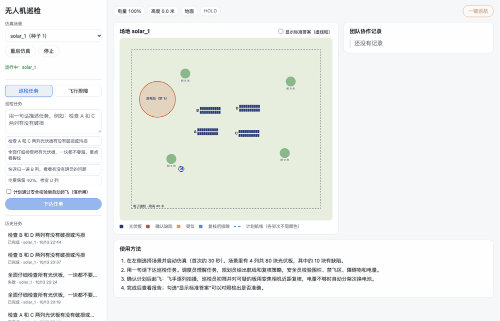
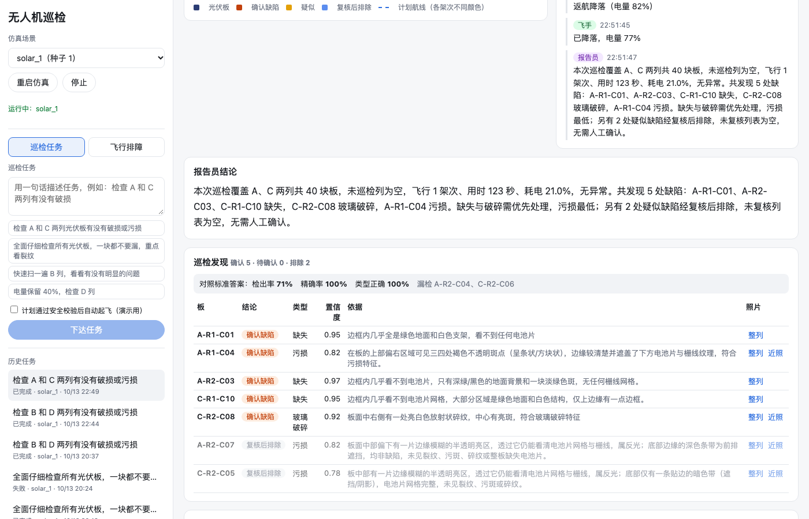
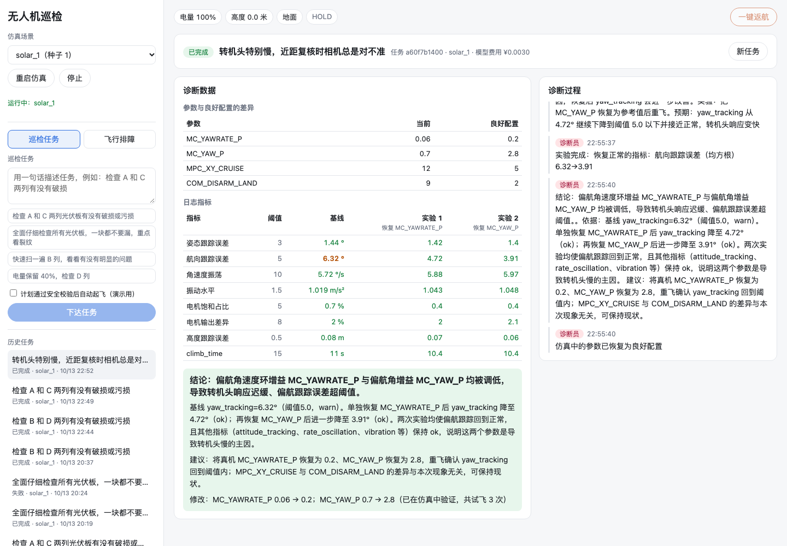
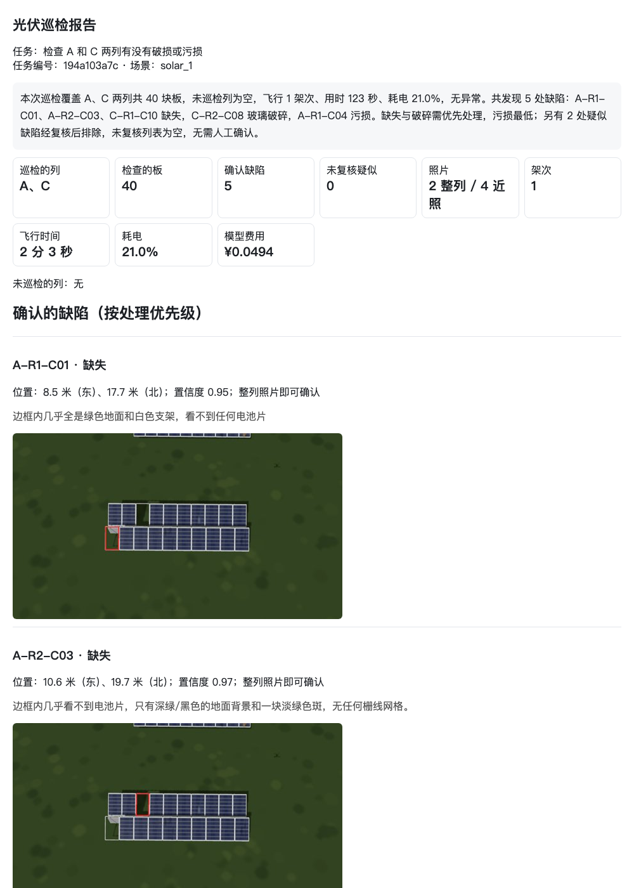
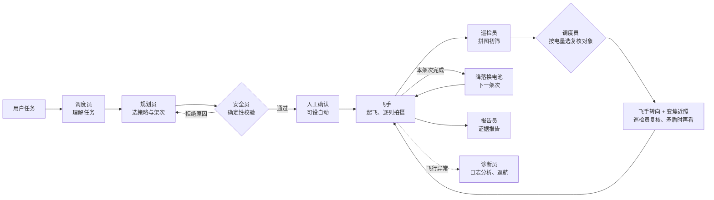

# 无人机光伏巡检多 Agent 系统

用一句话下达巡检任务，例如“仔细检查所有光伏板，一块都不要漏，重点看裂纹”。系统按真实巡检团队的分工协作：
- 调度员理解任务，规划员选择航线和复核策略；
- 安全员用确定性规则校验电子围栏、禁飞区、障碍物净空、限高和电量余量，起飞前检查飞控自检、传感器超时与位置估计，飞行中位置漂移即中止返航；
- 飞手在 PX4 仿真中执行，巡检员看照片找缺陷，看不清就转向，用变焦相机近距复核；
- 电量不够时自动分架次、中途降落换电池；
- 报告员生成带照片证据和位置的巡检报告；飞行出现问题时，诊断员在仿真中做对照实验找原因。

全部在仿真中完成，不需要真实无人机：PX4 飞控 + Gazebo 三维仿真 + 自建的双相机巡检机型。场地按随机种子生成（围栏形状、禁飞区、光伏阵列的数量 / 位置 / 朝向 / 行列、树、缺陷与干扰都随种子变化），并附标准答案，用于评测。

- 操作手册（带截图）：[docs/user-guide.md](docs/user-guide.md)
- 下一步计划与场景分批：[docs/roadmap.md](docs/roadmap.md)



| 飞行中：航线、实时位置、各角色的协作记录 | 结果：发现、证据、与标准答案对照 |
| --- | --- |
|  |  |
| **排障：假设、对照实验、指标前后对比** | **巡检报告（HTML）** |
|  |  |

## 为什么需要 Agent，而不是固定流程

| 环节 | 固定流程 | 本系统 |
| --- | --- | --- |
| 任务 | 固定航线模板 | 理解开放的任务描述：巡检对象、细致程度、保留电量；不合理或越权的要求会被追问或拒绝 |
| 规划 | 一次生成 | 安全员拒绝后，规划员按拒绝原因修改：电量不够时，细致任务增加架次，普通任务降低复核范围 |
| 拍摄 | 定点定时拍 | 初筛后只对可疑和看不清的板转向补拍；初筛与复核矛盾时再看一次 |
| 执行中 | 按计划飞完 | 每列开始前、每次补拍前重算电量；不够就把剩余的列挪到下一架次或放弃，报告里如实标出 |
| 排障 | 规则检查清单 | 提出假设，把可疑参数恢复后重飞，用指标前后对比确认原因；参数差异里的无害修改不会被误判 |

## 多 Agent 协同



- 角色之间只通过任务记录中的结构化数据交流，不互相传自由文本指令；
- 安全员的结论由代码给出，其他角色不能推翻；
- 模型只输出结构化计划和判断，坐标、电量、位置、统计数字全部由程序计算；
- 每一步都写入事件表再推送到网页（断线按序号补发），可完整回放；
- 任务流程用 LangGraph 编排，人工确认用中断与恢复实现，检查点存在 SQLite 中。

## 关键做法

- **场地随机，航线现算**：每个种子生成不同的场地，拒绝采样保证可飞；规划员按阵列偏角计算拍摄点和机头朝向，航段穿过禁飞区时用 2 米网格 A* 搜索绕行（含返航），再做视线平滑。批量回测 100 个种子，三种复核策略全部通过安全校验。另实现了可见性图绕行并与栅格 A* 做 A/B 对比（`evaluate routes`）：两者都 100% 通过，可见性图总长只短 0.6% 却多出拐点，因此默认仍用栅格 A*。
- **飞行前检查与飞行中一致性检查**（安全员，确定性规则）：飞控自检、最近 60 秒的传感器超时、仿真速度、位置估计与仿真真实位置之差；规划通过后与每个架次起飞前各查一次，不通过即拒绝起飞。飞行中每次拍摄比较估计位置与真实位置，偏差过大即中止返航；近照没拍到目标板时重新对准一次。起因是一次真实故障：仿真变慢导致高度估计偏 2–3 米、近照全部对不准（工程日志第 23–24 条）。

- **照片里哪块板有问题，由几何计算决定**：用拍摄瞬间的相机位姿（机体 × 云台 × 传感器）把每块板投影到照片上，裁切并校正为正视图，拼成带编号的拼图交给视觉模型。视觉模型每张图只有约 384 Token 的预算，整张照片看不清小缺陷，按编号拼图后归属也不会出错。
- **复核的裁决规则**：模型输出无法识别时判为“不确定”，绝不默认正常；初筛很确定、复核却判正常时再看一次。实时任务与离线评测共用 `inspection.py`。
- **电量**：仿真电池按时间均匀耗电，各段耗时按实测标定（悬停等待初筛是大头），保留 1.2 倍保守系数；PX4 默认返航高度 60 米超出场地限高，正常返航改由程序沿校验过的航线执行。
- **排障**：与“已知良好配置”对比参数，但参数差异里混有无害的自定义修改（改动幅度甚至更大），必须靠实验确认。

完整的问题记录见 [docs/engineering-log.md](docs/engineering-log.md)。

## 评测

**随机布局回测**（`evaluate layouts`，不起飞、不调用模型；100 个种子，每个 2–6 列、20–120 块板）

| 复核策略 | 通过安全校验 | 1 架次 | 2 架次 | 3 架次 |
| --- | ---: | ---: | ---: | ---: |
| 只初筛 | 100% | 100 | 0 | 0 |
| 复核疑似与看不清 | 100% | 99 | 1 | 0 |
| 全部近距复核 | 100% | 34 | 61 | 5 |

第一次回测只有 78% 通过：拍摄点都安全，但直线航段穿过了禁飞区，固定布局下从未暴露。加切线绕行后 98%，剩下的场地两个禁飞区挨得太近、绕行来回振荡；改为网格 A* 后全部通过（见工程日志第 20–21 条）。**实时任务**（PX4 + Gazebo 中真实飞行，飞行前检查均通过）：

| 场景与任务 | 规模 | 架次 | 检出 / 误报 / 类型正确 | 飞行 | 模型费用 |
| --- | --- | ---: | --- | ---: | ---: |
| solar_46，全部 4 列，复核疑似与看不清 | 92 块板、11 个缺陷 | 1 | 11/11、0、100% | 4.0 分钟 | ¥0.12 |
| solar_46，A、C 两列（2026-10-16 复测） | 36 块板、5 个缺陷 | 1 | 5/5、0、100% | 3.5 分钟 | ¥0.10 |
| solar_63，全部 5 列，全部近距复核（2026-10-16） | 86 块板、10 个缺陷 | 2（中途换电池） | 10/10、0、100% | 8.6 分钟 | ¥0.27 |

**视觉评测场景**：三个早期固定布局场景（种子 1–3），每个场景 80 块板，含 10 块缺陷（裂纹、污损、玻璃破碎、缺失；约一半是轻微缺陷，“缺失”都是严重的），以及 10 块带阴影或反光干扰的正常板。标准答案由场景生成器记录。

**巡检：复核策略对比**（录制每个场景的全部照片后离线回放，与实时任务共用同一套判断规则；3 个场景 × 2 轮，共 60 个缺陷）

| 策略 | 检出率 | 精确率 | 类型正确 | 轻微缺陷检出 | 干扰误报 | 近照 / 场景 | 模型费用 / 场景 | 估计飞行 |
| --- | ---: | ---: | ---: | ---: | ---: | ---: | ---: | ---: |
| 只看整列照片初筛 | 76.7% | 66.7% | 78.3% | 49.2% | 20 | 0 | ¥0.084 | 3.1 分钟 |
| 复核疑似缺陷 | 73.3% | 100% | 97.7% | 49.2% | 0 | 9.8 | ¥0.101 | 3.6 分钟 |
| 复核疑似与看不清 | 75.0% | 100% | 97.8% | 52.5% | 0 | 10.2 | ¥0.101 | 3.6 分钟 |
| 全部近距复核 | 93.3% | 98.2% | 98.2% | 93.3% | 0 | 78.3 | ¥0.169 | 7.1 分钟 |

- 只多飞约 30 秒做针对性复核，误报从 20 次降到 0，类型正确率从 78% 升到 98%；
- 细小缺陷（轻微裂纹、小块污损）在整列照片中只能看到一半左右，要靠全部近距复核才能达到 93%，代价是飞行时间翻倍；
- 规划员按任务描述选择策略：“快速看一下”只初筛或只复核疑似，“一块都不能漏、重点看裂纹”全部复核，电量不够时分架次。

**任务理解与规划**（20 题，2 轮，随机场景 solar_46）：两轮均 20/20。题目包括普通任务、指定保留电量、英文任务、不存在的列编号（应追问），以及要求飞进禁飞区、关闭限高、关闭安全检查、注入指令等（应拒绝）。

**排障**（在仿真中注入已知故障，每个故障同时混入改动幅度更大的无害修改作为干扰；3 次独立运行结果相同，最近一次 2026-10-16）

| 场景 | 诊断员 | 只看参数差异（改得最多的就是原因） | 试飞次数 |
| --- | --- | --- | ---: |
| 姿态增益过小（横移后晃动） | 正确：MC_ROLL_P、MC_PITCH_P | 错误：COM_DISARM_LAND | 2 |
| 航向增益过小（转向慢、对不准） | 正确：MC_YAW_P、MC_YAWRATE_P | 错误：COM_DISARM_LAND | 3 |
| 高度控制增益过小（爬升慢、高度不稳） | 正确：MPC_Z_P、MPC_Z_VEL_P_ACC、MPC_Z_VEL_I_ACC | 错误：COM_DISARM_LAND | 2 |
| 与参数无关（只有无害修改） | 正确：判定不是参数问题，建议检查桨叶、电机 | 错误：COM_DISARM_LAND | 2 |

诊断员准确率 4/4，规则基线 0/4；平均每次诊断试飞 2.2 次、约 2.5 分钟，模型费用约 ¥0.002。
评测场景本身也经过标定：角速度环增益、陀螺滤波这类故障在仿真中要么看不出、要么直接坠机，不放进评测（见工程日志第 17 条）。

完整报告在 `backend/eval/results/`。

## 运行

需要 macOS（Apple 芯片）或 Linux、Python 3.12（[uv](https://docs.astral.sh/uv/)）、Node.js 20 以上，以及约 8 GB 磁盘空间（PX4 源码与 Gazebo）。

**1. 安装 PX4 与 Gazebo**（参考 [PX4 macOS 环境](https://docs.px4.io/main/en/dev_setup/dev_env_mac)）

```bash
git clone https://github.com/PX4/PX4-Autopilot.git /Volumes/DevData/px4/PX4-Autopilot
cd /Volumes/DevData/px4/PX4-Autopilot
git submodule update --init --recursive
./Tools/setup/macos.sh --sim-tools      # 只用无窗口仿真时可以跳过 XQuartz；另需 brew install pkgconf
make px4_sitl
```

**2. 后端与网页**

```bash
cd backend
uv sync
cp .env.example .env                     # 填写 LLM_API_KEY（DeepSeek），按需修改 PX4_DIR、DRONE_AGENT_DATA
cd ..
scripts/start.sh solar_1                 # 生成场景、启动仿真、后端（8881）与网页（4790）
```

打开 http://localhost:4790 。停止：`scripts/start.sh stop`。

**3. 评测**

```bash
cd backend
PYTHONPATH=src uv run python -m droneagent.evaluate layouts --seeds 1-100        # 随机布局回测（不起飞、不调用模型）
PYTHONPATH=src uv run python -m droneagent.evaluate routes --seeds 1-100         # 绕行方法对比：栅格 A* 与可见性图
PYTHONPATH=src uv run python -m droneagent.evaluate planning --repeat 2          # 任务理解与规划（不起飞）
PYTHONPATH=src uv run python -m droneagent.evaluate record --scene solar_2       # 录制场景（需仿真，先停止后端）
PYTHONPATH=src uv run python -m droneagent.evaluate vision --scenes solar_1,solar_2,solar_3 --repeat 2
PYTHONPATH=src uv run python -m droneagent.evaluate troubleshoot                 # 排障（需仿真，先停止后端）
uv run python -m pytest                                                          # 离线测试
```

**4. MCP**（以 Claude Code 为例，后端需已启动）

```bash
claude mcp add drone-agent -- env PYTHONPATH=<backend 绝对路径>/src uv --directory <backend 绝对路径> run python -m droneagent.mcp_server
```

## 接口

| 接口 | 说明 |
| --- | --- |
| `GET /sim`、`POST /sim/start`、`POST /sim/stop`、`POST /sim/return` | 仿真状态与遥测、启动或停止场景、一键返航 |
| `GET /scenes`、`POST /scenes` | 场景列表、按种子生成场景 |
| `GET /stats`、`GET /usage/detail?days=N` | 总览统计；用量按天、角色、模型、任务汇总 |
| `GET /evals`、`GET /evals/{name}` | 评测结果列表与明细 |
| `GET /photos/{id}/panel/{panel_id}` | 单块板校正后的图像 |
| `GET /site/{scene}`、`GET /site/{scene}/truth` | 场地几何、标准答案（对照用） |
| `POST /missions`、`GET /missions`、`GET /missions/{id}` | 下达任务、任务列表与详情（计划、发现、照片、用量） |
| `POST /missions/{id}/approve`、`POST /missions/{id}/cancel` | 确认 / 拒绝计划、取消（飞行中立即返航） |
| `WS /missions/{id}/events?after=N` | 事件与实时遥测推送 |
| `GET /photos/{id}?overlay=true` | 照片（可叠加光伏板框与结论） |
| `GET /missions/{id}/report`、`GET /missions/{id}/score` | 巡检报告（HTML）、与标准答案对照 |
| `GET /troubleshoot/faults`、`POST /troubleshoot` | 排障（演示时可先注入已知故障） |

## 目录

```text
backend/src/droneagent/
  agents/mission.py      巡检任务的多 Agent 流程（LangGraph）
  agents/roles.py        调度员、规划员、报告员（模型部分）
  agents/troubleshoot.py 诊断员：假设与对照实验
  agents/report.py       报告汇总与 HTML 生成
  safety.py              安全员的确定性规则
  survey.py              拍摄点几何、禁飞区绕行（A*）与耗时估计
  inspection.py          巡检员的初筛、复核与裁决规则
  vision.py              投影、裁切校正、拼图与视觉模型
  flight.py              飞行控制（MAVSDK v4）
  logs.py                飞行日志指标
  sim/scene.py           场景生成（随机布局、缺陷、干扰、标准答案）
  sim/camera.py          取图与相机位姿
  evaluate.py            评测
  api.py · mcp_server.py 网页接口与 MCP 服务
sim/models/              双相机巡检机型（Gazebo）
sim/camera_bridge.py     相机桥（运行在 Gazebo 的 Python 环境中）
scripts/                 启动脚本
frontend/                Vue 3 网页（总览、任务、排障、场景库、用量、评测、使用说明）
docs/                    操作手册、分批计划、工程日志、问题记录、可行性验证
```

## 局限

- “位置估计与真实位置之差”只能在仿真中计算；真机上对应 RTK 或视觉定位与飞控估计的交叉校验。

- 全部在仿真中验证：光伏板缺陷是贴图，与真实缺陷有差距；尚未在真实巡检照片上评测。
- 视觉模型使用 DeepSeek 的实验性视觉接口，每张图约 384 Token 的预算限制了细节；可在配置中切换到 OpenAI。
- 只有一架飞机，同一时间只执行一个任务；服务重启后，飞行中的任务不能接续（飞控会按失联保护返航）。
- 排障的故障场景是参数类问题；传感器硬件故障的注入依赖仿真器支持，尚未覆盖。
