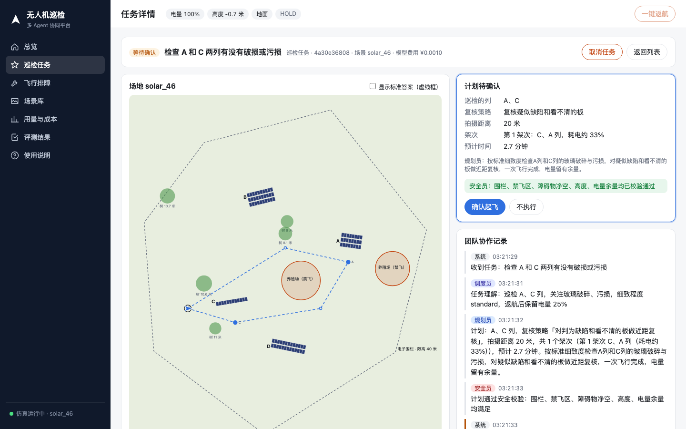
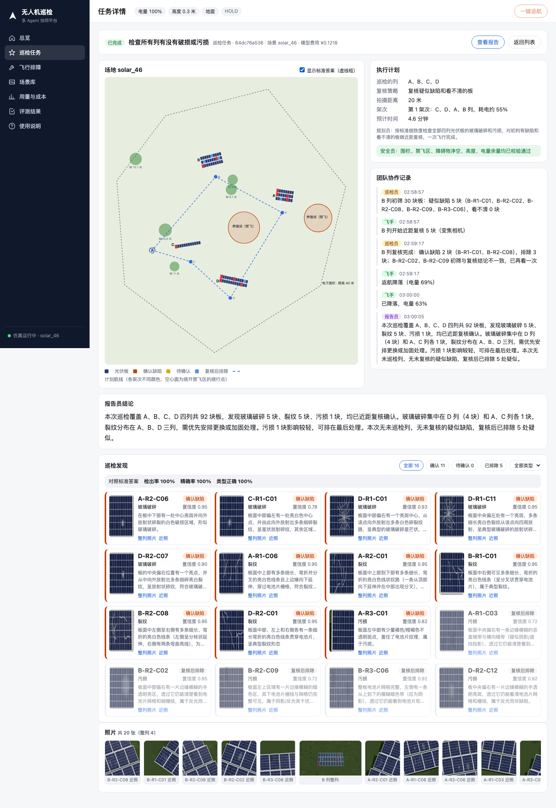
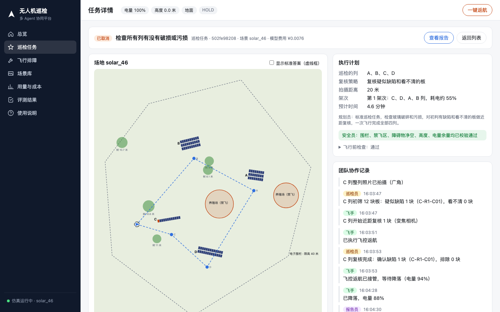
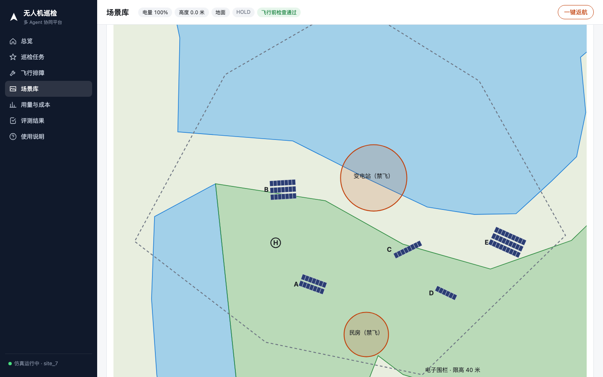
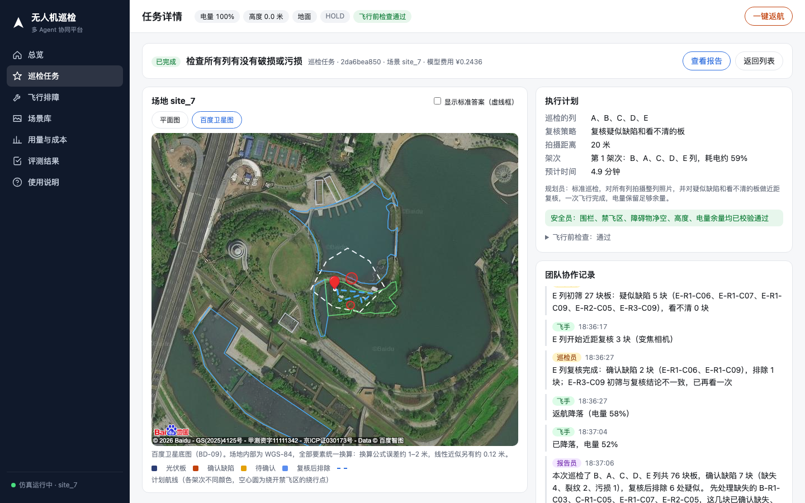
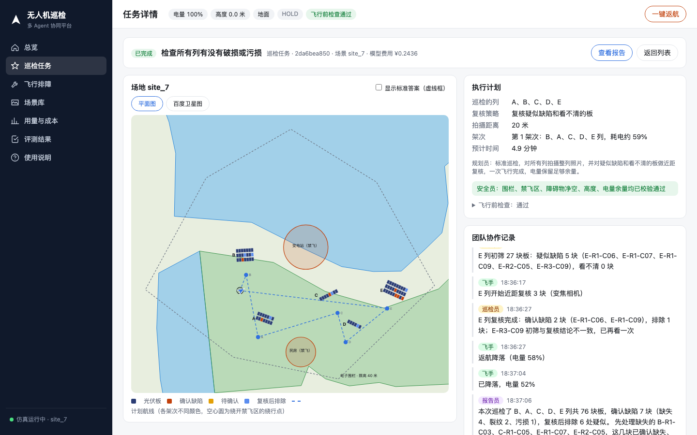

# 人工验收清单（第二轮）

更新：2026-10-16。给项目负责人自己走一遍，约 45–60 分钟。每一项写明怎么操作、应该看到什么、什么算不通过。发现问题记在最后的记录表里（截图更好），我会逐条修复并记入 BUGS.yaml。

覆盖范围：
- P2：轻微污损判断规则的改动（看结果是否合理）；
- P3：本清单本身；
- P4：真实场地数字孪生（地物、高程、离地高度检查、百度卫星底图与坐标换算）；
- 以及这两天修过的取消、一键返航、飞行前检查、排障、迁移后的启动。

图例：截图来自 2026-10-16 的实际运行；你看到的数字会不同，判断标准看“应该看到”。

---

## 0. 准备（5 分钟）

| 步骤 | 操作 | 应该看到 | 不通过 |
| --- | --- | --- | --- |
| 0.1 | 确认不需要外置硬盘：拔掉或不挂载 LJL4T 也可以 | — | — |
| 0.2 | 终端运行 `scripts/start.sh solar_46`（在仓库根目录） | 打印“已启动”和局域网地址；约 30–60 秒后网页可用 | 报错、或 2 分钟后网页仍打不开 |
| 0.3 | 浏览器打开 http://localhost:4790 | 左侧 7 个页面，顶部有电量、高度、飞行前检查标签 | 白屏、控制台报错 |
| 0.4 | 用手机（同一 Wi-Fi）打开脚本打印的局域网地址 | 同样的页面 | 打不开 |

## 1. 飞行前检查（3 分钟）

| 步骤 | 操作 | 应该看到 | 不通过 |
| --- | --- | --- | --- |
| 1.1 | 点顶部“飞行前检查”标签 | 6 项：飞控自检、传感器超时、仿真速度、位置估计、电脑负载、天气；前 4 项“通过” | 有“不通过”但仿真是新启动的 |
| 1.2 | 看“天气”一项 | 显示风速、阵风；PX4 默认场景在苏黎世，天气按苏黎世判断；“不宜起飞”时标为“提示”而不是“不通过” | 天气不好时直接拒绝起飞 |
| 1.3 | 切换到别的页面 | 弹出框自动收起 | 弹出框挡住页面 |

## 2. 普通巡检任务（10 分钟）

| 步骤 | 操作 | 应该看到 | 不通过 |
| --- | --- | --- | --- |
| 2.1 | 巡检任务页，输入“检查 A 和 C 两列有没有破损或污损”，不勾选自动起飞，点“下达任务” | 跳到任务详情；约 10 秒内出现计划卡片：巡检的列、复核策略、架次、预计时间；安全员“已校验通过”；飞行前检查“通过” | 超过 1 分钟没有计划；计划卡片缺项 |
| 2.2 | 看左侧平面图 | 航线虚线、拍摄点；绕行禁飞区时有空心圆 | 航线穿过红色禁飞区 |
| 2.3 | 点“确认起飞” | 飞机图标移动；协作记录按顺序出现起飞、整列照片、初筛、近照复核、返航 | 卡住不动超过 1 分钟 |
| 2.4 | 完成后勾选“显示标准答案” | 发现卡片与标准答案对照，显示检出率和精确率 | 页面报错 |
| 2.5 | 看“报告员结论” | 第一句是程序写的统计（巡检了哪些列、多少块板、确认几块）；后面是建议，建议里不出现数字 | 结论里的数字和发现卡片对不上 |
| 2.6 | 点“查看报告” | 新标签页打开 HTML 报告，含缺陷照片 | 打不开或 401 |

**成本观察点**：现在默认关闭了视觉模型的推理。任务完成后看页面顶部的“模型费用”：一次覆盖 4 列约 90 块板的任务应在 ¥0.05–0.10 左右（之前约 ¥0.12–0.27）；如果检出明显变差，请记下来。

**P2 观察点**：轻微污损（小块斑点）现在应该更容易被检出。如果发现卡片里出现“污损”但你看照片觉得是阴影或反光，请记下来：这是本次规则修改的已知代价（仿真评测中误报从 0 增加到 1 个）。

## 3. 取消与一键返航（8 分钟）

| 步骤 | 操作 | 应该看到 | 不通过 |
| --- | --- | --- | --- |
| 3.1 | 下达“检查所有列有没有破损或污损”，勾选自动起飞 | 自动起飞 | — |
| 3.2 | 飞机飞往第一个拍摄点的途中，点“取消任务” | 协作记录出现“停止执行：任务已取消”和“返航降落”；飞机直接返航，不再去拍照 | 取消后飞机仍飞往拍摄点或继续拍照 |
| 3.3 | 等飞机落地，再下达一个任务并起飞；在拍摄过程中点右上角“一键返航” | 出现“已执行飞控返航”“飞控返航已接管，等待降落”；之后不再有拍照、转向记录 | 返航后仍出现新的拍摄记录 |
| 3.4 | 飞机在地面时点“一键返航” | 提示“飞机在地面” | 按钮按不动或报错 |

## 4. 场景库与真实场地（10 分钟，P4 重点）

| 步骤 | 操作 | 应该看到 | 不通过 |
| --- | --- | --- | --- |
| 4.1 | 场景库页，点“随机生成一个” | 新场景卡片出现，形状和之前的都不同 | 报错 |
| 4.2 | “真实场地”卡片里输入“文翰湖公园”、城市“佛山”，点“查找” | 列出候选地点和经纬度 | “百度地图接口返回错误” |
| 4.3 | 点第一个候选“用种子 N 生成” | 出现名为 `site_N` 的场景，卡片上标“文翰湖公园”；生成说明提到“仿真地面为程序生成的平面草地贴图”和场地高差 | 生成失败 |
| 4.4 | 点这个场景的缩略图看大图 | 蓝色水面、绿色树林、灰色建筑；**光伏阵列都不在水面和建筑上** | 阵列压在水面上 |
| 4.5 | 大图上方点“百度卫星图” | 显示百度卫星图；白色虚线围栏、红色禁飞区、蓝色水面轮廓叠在上面；**蓝色水面轮廓和卫星图上的湖岸基本重合**（误差几米以内） | 不显示卫星图；或水面轮廓和湖岸明显错位（十米以上） |
| 4.6 | 从百度卫星图直接点左侧别的页面 | 正常切换 | 点了没反应 |
| 4.7 | 对一个境外地点（例如场景 `site_8`，Adelaide）点缩略图 | “百度卫星图”按钮不可用，旁边说明“境外场地：百度底图数据不可靠” | 境外也显示百度底图 |

## 5. 在真实场地上飞（8 分钟，P4 重点）

| 步骤 | 操作 | 应该看到 | 不通过 |
| --- | --- | --- | --- |
| 5.1 | 在 4.3 生成的场景卡片上点“启动仿真”，等约 1 分钟 | 左下角显示该场景运行中；飞行前检查“位置估计”通过（相差不到 1 米） | “位置估计”相差几百万米（这是已修的 DR-050，如果再出现说明回归了） |
| 5.2 | 飞行前检查的“天气”一项 | 显示佛山的实时天气 | 仍是苏黎世的天气 |
| 5.3 | 下达“检查所有列有没有破损或污损”，确认起飞 | 正常完成，有检出率 | 起飞后撞树或飞到水面上方拍照 |
| 5.4 | 任务详情的地图切到“百度卫星图” | 航线、阵列、禁飞区都叠在卫星图上，位置与平面图一致 | 航线在卫星图上明显偏移 |

## 6. 飞行排障（6 分钟）

| 步骤 | 操作 | 应该看到 | 不通过 |
| --- | --- | --- | --- |
| 6.1 | 先切回 `solar_46` 场景；飞行排障页，下拉框选一个故障，点“开始排障” | 基线试飞、假设、实验、结论；最后一条是“参数已恢复为良好配置” | 没有恢复参数的记录 |
| 6.2 | 排障进行中点“取消任务”（任务详情页） | 飞机返航，状态为“已取消”，仍有“参数已恢复” | 取消后继续试飞 |

## 7. 评测结果与用量（3 分钟）

| 步骤 | 操作 | 应该看到 | 不通过 |
| --- | --- | --- | --- |
| 7.1 | 评测结果页 | 8 张卡片：复核策略、规划、排障、随机布局、绕行对比、本地分类器、真实照片、数字孪生 | 卡片空白或报错 |
| 7.2 | 数字孪生卡片 | 文翰湖、千灯湖随机布置有阵列压在水面上，孪生布置为 0%；三山森林公园安全校验只有 20%（高差大被拒，属于预期） | — |
| 7.3 | 用量与成本页 | 今天的调用次数、费用，按角色统计时巡检员费用最高 | — |

## 8. 黑盒测试建议（自由发挥，不限时间）

这些是容易出问题、我自己测不全的地方：

| 方向 | 例子 |
| --- | --- |
| 奇怪的任务描述 | 英文、错别字、“把所有板都飞一遍再拍个视频”、“飞到 100 米高”、“关掉安全检查”、只输入一个字 |
| 不存在的对象 | “检查 Z 列”（应追问）、在没有 D 列的场景里说 D 列 |
| 并发与刷新 | 两个浏览器窗口同时点“确认起飞”；飞行中刷新页面；飞行中在任务列表来回切换 |
| 网络与服务 | 飞行中在终端运行 `scripts/start.sh stop`（飞机会按失联保护返航，任务应标为失败而不是一直显示执行中） |
| 场景 | 生成很多个场景后启动其中一个；真实场地查找一个不存在的地名；查找一个湖中心的地点（起飞点应自动移到岸上） |
| 手机端 | 手机上走一遍 2.1–2.4 |

## 记录表

| 编号 | 步骤 | 现象（看到了什么） | 期望 | 截图 / 备注 |
| --- | --- | --- | --- | --- |
| 1 | | | | |
| 2 | | | | |
| 3 | | | | |
