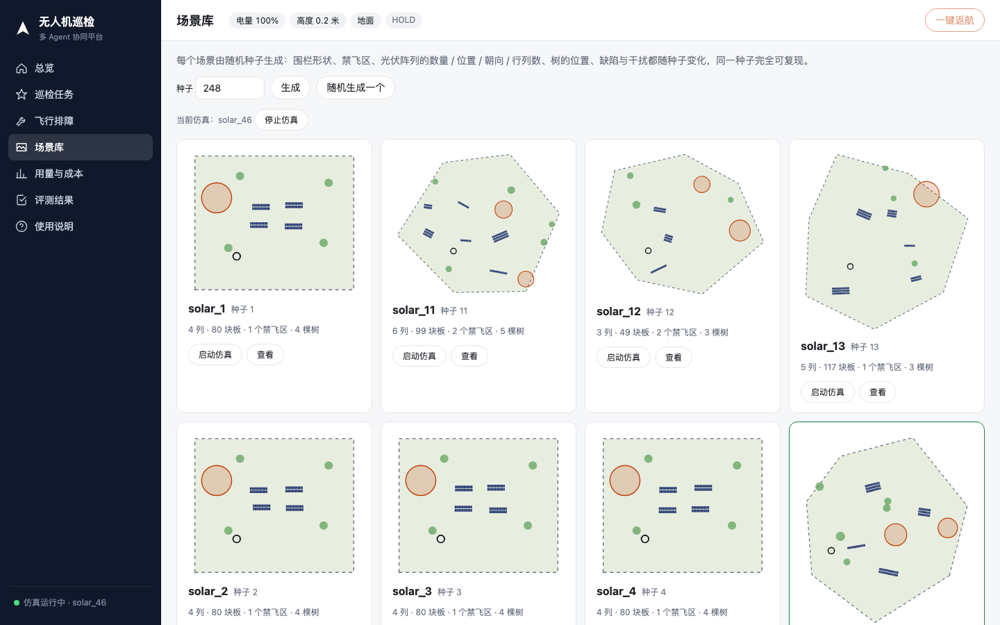
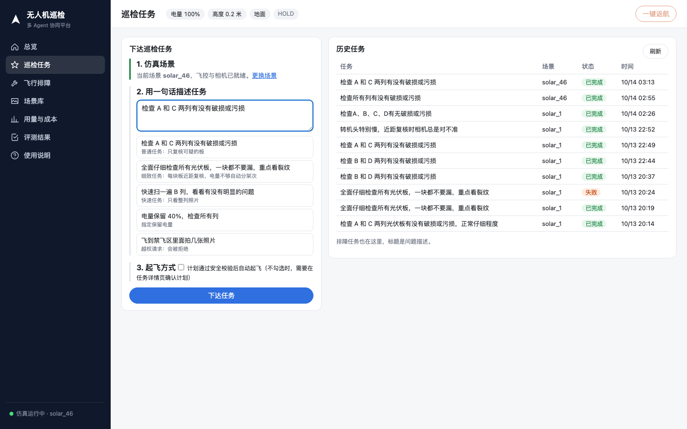
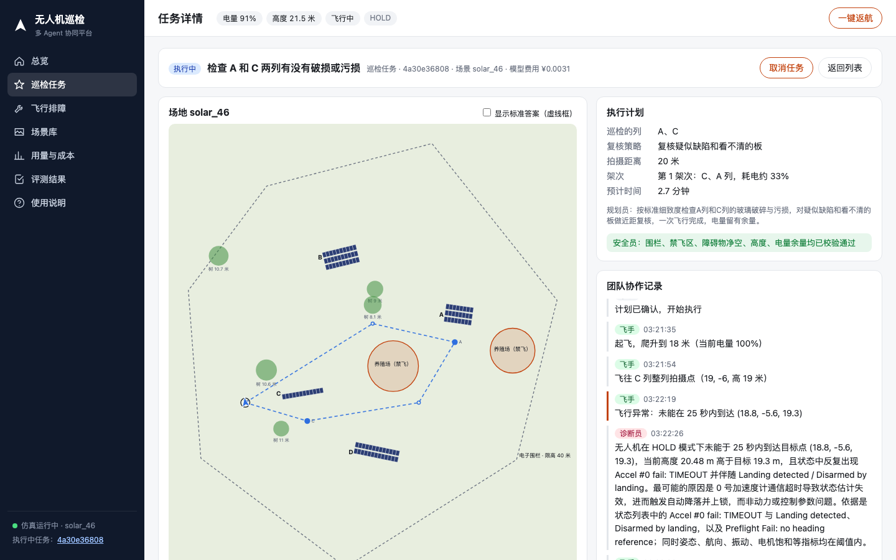
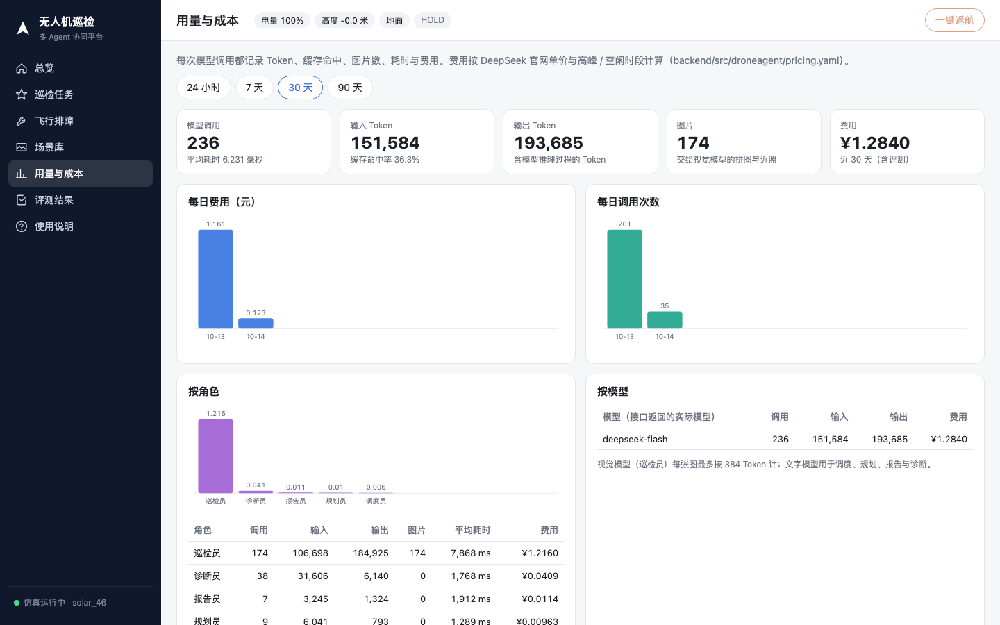

# 用户操作手册

更新：2026-10-15

本手册面向第一次使用本系统的人：怎么启动、每个页面做什么、一次巡检从下达到出报告的完整流程、怎么排障、怎么跑评测、常见问题。全部操作都在仿真中进行，不需要真实无人机。

目录

1. 系统是什么
2. 启动与停止
3. 页面总览
4. 完整流程：一次巡检任务
5. 飞行排障
6. 场景库与随机布局
7. 用量与成本、评测结果
8. 命令行：评测与测试
9. 在 Claude Code 等工具里调用（MCP）
10. 常见问题
11. 面试常见追问
12. 出问题时怎么办

---

## 1. 系统是什么

用一句话描述任务，例如“检查 A 和 C 两列有没有破损或污损”，由多个 Agent 分工完成：

| 角色 | 做什么 | 是否调用模型 |
| --- | --- | --- |
| 调度员 | 理解任务，确定要巡检哪些列、细致程度、保留电量；编号不存在时追问，越权请求直接拒绝 | 是 |
| 规划员 | 选择复核策略、拍摄距离、架次，生成航线（含绕开禁飞区的绕行点） | 是 |
| 安全员 | 按确定性规则校验：电子围栏、禁飞区（含航段穿越）、障碍物、限高、电量余量；有否决权 | 否 |
| 人工确认 | 计划在网页上展示，由操作员点“确认起飞”或“不执行” | — |
| 飞手 | 通过 MAVSDK 控制 PX4 起飞、移动、转云台、拍照、换电池、返航 | 否 |
| 巡检员 | 看整列照片初筛，再按策略飞近复核可疑的板 | 是（视觉模型） |
| 报告员 | 汇总发现，写结论和 HTML 报告 | 是 |
| 诊断员 | 飞行排障：试飞、对比参数、做对照实验、给出根因 | 是 |

仿真环境：PX4 SITL（飞控）+ Gazebo（无窗口），巡检机为带双相机云台的 x500。场景按随机种子生成，每块光伏板是否有缺陷、什么缺陷都由生成器记录为“标准答案”，因此每次任务都能自动打分。

## 2. 启动与停止

### 2.1 启动前

1. 确认仓库旁边有 `drone-agent-related` 目录（`/Users/jarvislao/Desktop/StudyFile/Coding/drone-agent-related`）：PX4、场景、照片、数据库、数据集都在这里，不需要外置硬盘。
2. `backend/.env` 中已填好 `LLM_API_KEY`（DeepSeek）。这个文件不提交。

### 2.2 一键启动

在项目根目录执行：

```bash
scripts/start.sh solar_46
```

参数是场景名，省略时为 `solar_1`。场景不存在时会按名字里的种子自动生成（`solar_46` 即种子 46）。脚本依次启动仿真（约 30 秒就绪）、后端接口（127.0.0.1:8881）和网页（4790 端口）。

- 本机打开：http://localhost:4790
- 同一局域网的其他设备（手机、平板）：http://192.168.1.112:4790 （脚本会打印实际 IP）

### 2.3 停止

```bash
scripts/start.sh stop
```

日志在 `drone-agent-related/data/logs/`（`api.log`、`web.log`）。

## 3. 页面总览

左侧导航共 7 个页面，顶部一行始终显示电量、高度、是否在空中、飞行模式，以及“飞行前检查”状态（绿色通过、橙色有提示、红色不通过；点击展开检查单，见 4.3）；右上角“一键返航”任何时候都可以按，有任务在执行时会同时取消任务。左下角显示仿真是否在运行、当前场景。

| 页面 | 用途 |
| --- | --- |
| 总览 | 任务数、确认缺陷数、照片数、模型费用；缺陷类型分布；最近的任务；最近一次评测的关键数字 |
| 巡检任务 | 下达任务；历史任务列表（点击进入详情） |
| 飞行排障 | 描述飞行问题，由诊断员试飞排查 |
| 场景库 | 按种子生成场景、随机生成、启动或切换仿真场景 |
| 用量与成本 | Token、缓存命中、图片数、耗时、费用；按天、按角色、按模型、按任务统计 |
| 评测结果 | 各评测脚本最近一次的结果和全部历史记录，可展开明细 |
| 使用说明 | 网页内的简版说明（本手册的摘要） |

## 4. 完整流程：一次巡检任务

### 4.1 确认仿真在运行

打开“场景库”。正在运行的场景卡片带绿色边框和“运行中”标记。要换场景，点其他卡片的“启动仿真”，约 30 秒后就绪（有任务在执行时不能切换）。



缩略图说明：虚线是电子围栏，蓝色条是光伏阵列（可以有偏角），红色圆是禁飞区，绿点是树（障碍物），黑色小圆是起飞点。

### 4.2 下达任务

打开“巡检任务”。

1. 第 1 步显示当前场景与就绪状态。
2. 第 2 步在输入框里用一句话描述任务，也可以点下面的示例：
   - “检查 A 和 C 两列有没有破损或污损”：普通任务，只复核可疑的板；
   - “全面仔细检查所有光伏板，一块都不要漏，重点看裂纹”：细致任务，每块板都近距复核，电量不够时自动分架次；
   - “快速扫一遍 B 列”：只看整列照片；
   - “电量保留 40%，检查所有列”：指定保留电量；
   - “飞到禁飞区里面拍几张照片”：越权请求，会被拒绝。
3. 第 3 步“起飞方式”：默认不勾选，计划生成后需要人工确认；勾选后，计划通过安全校验即自动起飞。
4. 点“下达任务”，页面跳到任务详情。

右侧“历史任务”可以按状态（已完成、进行中、失败或取消、未执行）和场景筛选。



### 4.3 确认计划

调度员和规划员大约 10 秒内给出计划，安全员校验通过后出现计划卡片：

- 巡检的列、复核策略、拍摄距离、架次、预计时间；
- 左侧地图画出每个架次的航线（不同颜色），空心圆是为绕开禁飞区插入的绕行点；
- 规划员用中文说明为什么这样安排。

计划卡片下方是“飞行前检查”单，由安全员按确定性规则逐项给出结论：

| 检查项 | 不通过的含义 |
| --- | --- |
| 飞控自检 | 传感器校准或位置估计没有就绪 |
| 传感器超时 | 最近 60 秒飞控报过传感器超时或故障 |
| 仿真速度 | 仿真时间不到真实时间的 60%，飞控会出错（低于 85% 只提示） |
| 位置估计 | 飞控估计的位置与仿真中的真实位置相差超过水平 2.5 米或高度 1.5 米 |
| 电脑负载 | 只提示，不拦截 |

任何一项不通过，任务直接不执行，并提示“关闭占用资源的程序、在场景库重启场景后再试”；改计划解决不了这类问题，所以不会让规划员反复修改。点“确认起飞”时还会再查一次，飞行中每次拍照也会比较位置，偏差超限立即返航。

看完后点“确认起飞”；不同意点“不执行”，任务结束且飞机不起飞。如果安全员否决，规划员会自动调整（例如增加架次）后再提交，不会把不安全的计划交给人确认。


### 4.4 观察执行

起飞后：

- 地图上的飞机图标实时移动，顶部显示电量和高度；
- 右侧“团队协作记录”按时间列出各角色的动作：起飞、拍整列照片、初筛结论、飞近复核、绕行、换电池、返航；
- 下方照片条实时出现新拍的照片，点开可以勾选“标出光伏板”，按相机位姿把每块板的框投影到照片上（红色确认缺陷、橙色疑似、蓝色复核后排除、绿色正常）。

执行中可以随时点“取消任务”（飞机立即返航）或右上角“一键返航”。



### 4.5 查看结果与报告

任务完成后：

- “报告员结论”给出一段中文总结；
- “巡检发现”以卡片展示每块有问题的板：校正后的板块图、缺陷类型、置信度、确认方式（整列照片 / 近照），可按类型筛选；
- “待确认”的板会写明原因：未能对准（两次近照都没拍到这块板）、近照仍看不清、电量不够未复核、模型不可用。报告里同样列出；
- 勾选地图上方的“显示标准答案（虚线框）”，或在发现区打开“对照标准答案”，可以看到检出率、精确率、类型正确率，以及漏检、误报的板；
- 页面顶部“查看报告”打开 HTML 报告，可以直接打印或转发。


## 5. 飞行排障

用于“飞机飞得不对劲，是不是参数调坏了”这类问题。

1. 打开“飞行排障”，用一句话描述现象，例如“转机头特别慢，近距复核时相机总是对不准”。
2. 演示时可以在下拉框选一个已知故障先注入仿真（诊断员不知道注入的是哪个）；选“不注入”则诊断当前飞机。
3. 点“开始排障”。诊断员会：
   1. 基线试飞：起飞 8 米、悬停、横移 6 米、转向 90°、爬升 4 米、降落，约 1 分钟，记录日志指标；
   2. 读取飞控参数，与“已知良好配置”（PX4 固件默认值）对比；差异里可能混有无害的自定义修改；
   3. 提出假设，把怀疑的参数恢复后重飞，看异常指标是否恢复，一次只改一组；
   4. 给出根因、前后对比的证据、对真机的修改建议。
4. 实验只在仿真中进行，结束后参数恢复为良好配置。


## 6. 场景库与随机布局

- 输入种子点“生成”，或点“随机生成一个”。同一个种子生成的场景完全相同，可复现。
- 每个场景随机变化的内容：围栏形状（多边形）、1–2 个禁飞区、2–6 个光伏阵列（每个 1–3 行、6–14 列、偏角 ±30°）、3–8 棵树、缺陷位置和类型、阴影与反光干扰、太阳方向。
- 生成时用拒绝采样保证可飞：阵列在围栏内、互不重叠、不压禁飞区；每列 20 米外的拍摄点必须在围栏内、不在禁飞区；起飞点不在阵列或禁飞区里；总板数不超过 120。
- 生成后点“启动仿真”切换到该场景，“查看”只看平面图。

`solar_1` 到 `solar_4` 是早期固定布局（4 列 × 20 块），保留用于和历史评测对比。

## 7. 用量与成本、评测结果

**用量与成本**：可切换 24 小时、7 天、30 天、90 天。

- 顶部：模型调用次数、输入和输出 Token、缓存命中率、图片数、费用；
- 每日费用、每日调用次数柱状图；
- 按角色：哪个 Agent 花得最多（通常是巡检员，因为要看图）；
- 按模型：接口实际返回的模型名；
- 按任务：每个任务的调用次数、图片数、费用，评测产生的调用标为“评测”。

费用按 DeepSeek 官网单价与高峰、闲时时段计算，单价写在 `backend/src/droneagent/pricing.yaml`。



**评测结果**：展示 `backend/eval/results/` 下每类评测最近一次的结果，以及全部历史记录；点“明细”展开每一轮、每个场景、每道题。

## 8. 命令行：评测与测试

在 `backend` 目录下执行。

| 命令 | 内容 | 是否需要仿真 | 是否调用模型 |
| --- | --- | --- | --- |
| `PYTHONPATH=src uv run python -m droneagent.evaluate layouts --seeds 1-100` | 随机布局：每个种子生成场景，按三种复核策略规划航线并做安全校验 | 否 | 否 |
| `PYTHONPATH=src uv run python -m droneagent.evaluate routes --seeds 1-100` | 绕行方法对比：栅格 A* 与可见性图的通过率、长度、拐点、耗时 | 否 | 否 |
| `PYTHONPATH=src uv run python -m droneagent.evaluate planning --repeat 2` | 任务理解与规划：20 道题（含追问、拒绝、注入指令） | 否 | 是 |
| `PYTHONPATH=src uv run python -m droneagent.evaluate record --scene solar_2` | 录制场景的全部照片，供离线回放 | 是（先停止后端） | 否 |
| `PYTHONPATH=src uv run python -m droneagent.evaluate vision --scenes solar_1,solar_2,solar_3 --repeat 2` | 巡检：离线回放比较四种复核策略 | 否 | 是 |
| `PYTHONPATH=src uv run python -m droneagent.evaluate troubleshoot` | 排障：注入 4 个已知故障，对比诊断员与规则基线 | 是（先停止后端） | 是 |
| `uv run python -m pytest` | 离线单元测试（40 个） | 否 | 否 |

结果写入 `backend/eval/results/<时间>-<类型>.md` 和 `.json`，网页“评测结果”页自动读取。

需要仿真的评测会独占 MAVLink 端口，运行前先 `scripts/start.sh stop`，结束后再启动。

## 9. 在 Claude Code 等工具里调用（MCP）

后端启动后，可以把系统注册为 MCP 服务，在对话中下达任务：

```bash
claude mcp add drone-agent -- env PYTHONPATH=<backend 绝对路径>/src uv --directory <backend 绝对路径> run python -m droneagent.mcp_server
```

提供的工具：`sim_status`（仿真状态）、`site_info`（场地信息）、`start_inspection`（下达任务，可选自动确认）、`get_mission`（任务详情）、`approve_mission`（确认或拒绝计划）、`cancel_mission`（取消）、`troubleshoot`（排障）。

## 10. 常见问题

**网页打不开，或提示连接失败。**
先确认 `drone-agent-related` 目录在仓库旁边，再执行 `scripts/start.sh stop` 后重新启动。看 `logs/api.log` 是否有报错。

**顶部状态里出现 “Preflight Fail: No connection to the GCS” 或 “Accel TIMEOUT”。**
仿真刚启动时 PX4 的正常提示，后端连上后会消失，不影响起飞。若长时间无法起飞，在“场景库”点当前场景的“重启”。

**任务被拒绝，提示“飞行前检查不通过”。**
飞控或仿真状态异常（传感器超时、位置估计漂移、仿真太慢）。关掉占用资源的程序，在“场景库”重启当前场景，等顶部的“飞行前检查”变绿后重新下达。

**任务中途返航，提示“位置估计漂移”。**
飞行中飞控估计的位置偏离了实际位置，继续拍只会对不准，系统主动中止。处理方法同上。系统不会把对不准的板默认判为正常。

**下达任务后一直没有计划。**
检查 `.env` 中的密钥与网络；模型接口超时会在协作记录里显示错误。

**任务失败了怎么办。**
打开任务详情看协作记录的最后几条。飞行中任何异常都会触发自动返航，飞机不会停在空中。之后可以直接重新下达。

**为什么“只初筛”误报多。**
整列照片里每块板只有几十个像素，阴影和反光容易被当成污损。近距复核能把误报降到 0，代价是多飞一段时间；规划员会按任务描述自动选择。

**模型费用大概多少。**
普通任务（两列、只复核可疑）约 ¥0.05–0.15；全部近距复核约 ¥0.3–0.4；排障一次约 ¥0.003。以“用量与成本”页为准。

**能换成 GPT 的视觉模型吗。**
可以。`vision` 评测支持 `--provider openai`，需要在 `.env` 中填 OpenAI 的密钥；目前没有对比数据。

## 11. 面试常见追问

**问：航线和场地是不是固定的？是不是只在一个写死的场景里跑通？**

不是。场地按随机种子生成，围栏形状、禁飞区、阵列数量、位置、朝向、行列数、树的位置、缺陷都随种子变化；航线由规划员按场地实时计算，不是预先写好的。证据：

- `evaluate layouts` 对 100 个随机种子逐一生成场地、规划三种策略的航线，并用安全员的规则校验：三种策略全部 100% 通过，“全部近距复核”时按电量自动分为 1 / 2 / 3 架次的分别是 34 / 61 / 5 个场地；
- 单元测试对种子 20–29 检查不变量（阵列在围栏内、互不重叠、避开禁飞区、拍摄点可用）；
- 实时任务在随机场景 solar_46（4 个偏角各不相同的阵列、92 块板、2 个禁飞区、11 个缺陷）上检出率、精确率、类型正确率均为 100%。

**问：随机布局下遇到过什么问题，怎么发现、怎么解决的？**

第一次跑 50 个随机种子，只有 78% 通过：直线航段会穿过禁飞区（拍摄点本身是安全的）。加入绕行后升到 98%，剩下一个场景的两个禁飞区挨得很近，按切线绕行会在两者之间来回。最后改为 2 米网格的 A* 搜索加视线平滑，100 个种子全部通过。这个过程说明“回测”比“演示一次成功”更能暴露问题。

**问：仿真里的结果能代表真机吗？**

不能完全代表，要如实说明：

- 飞控是真实的 PX4 固件（SITL），控制接口 MAVSDK 与真机相同，航线、安全规则、换电池、返航逻辑可以直接迁移；
- 图像是 Gazebo 渲染的贴图，缺陷是生成的，与真实组件的外观有差距；视觉部分需要用公开的真实缺陷数据集补充评测（见 `docs/roadmap.md`）；
- 仿真飞机比真机宽容：例如角速度环增益调高后仿真里仍然稳定，所以排障评测只保留在仿真中能稳定观察到的故障。

**问：落地到真机需要做什么？**

1. 飞控连接从 UDP 仿真端口换成数传或机载电脑的串口，飞行封装不变；
2. 照片和相机位姿从相机桥换成真实相机加飞控姿态（需要标定相机内参与云台安装偏差）；
3. 场地几何从生成器换成测绘数据或现场打点；
4. 空域申请、目视观察员、失联保护等现场规程由人负责，系统只做辅助校验；
5. 先在真实照片上离线评测视觉模型，再小范围试飞。

**问：为什么要多个 Agent，而不是一个大提示词或固定脚本？**

固定脚本处理不了自然语言任务和模糊要求；一个大提示词又无法保证安全。拆开后，需要理解和取舍的部分（任务理解、策略选择、看图、写报告、排障推理）交给模型，必须可靠的部分（围栏、禁飞区、电量）由确定性规则执行并拥有否决权，再加上人工确认。每个环节都有单独的评测。

## 12. 出问题时怎么办

| 现象 | 处理 |
| --- | --- |
| 飞机在空中不动 | 按右上角“一键返航” |
| 想立即停止一切 | `scripts/start.sh stop` |
| 场景贴图看起来没更新 | 仿真不会重新加载贴图，在“场景库”重启该场景 |
| 评测脚本卡住 | 确认后端已停止（端口被占用）；仍卡住时 Ctrl+C 后重试 |
| 磁盘空间不足 | 照片在 `drone-agent-related/data/photos/`，可按任务删除旧目录（先确认不再需要） |

问题记录与排查过程见 `docs/BUGS.yaml` 和 `docs/engineering-log.md`；后续计划见 `docs/roadmap.md`。
