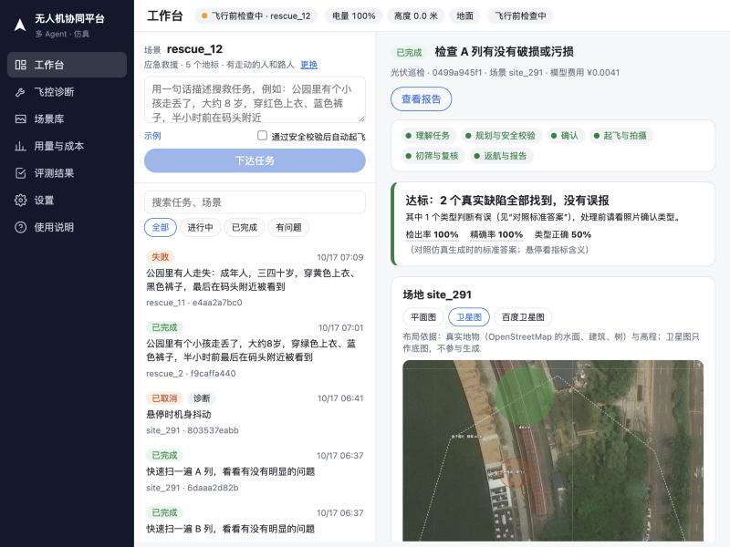
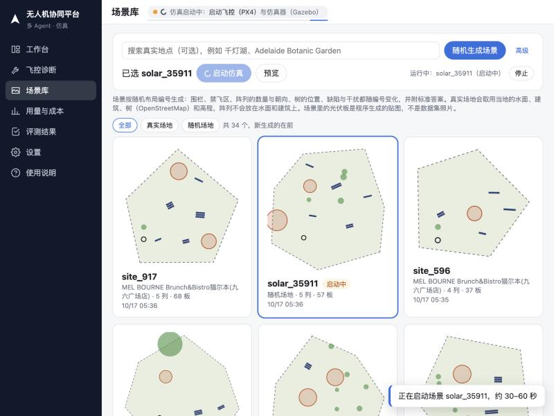
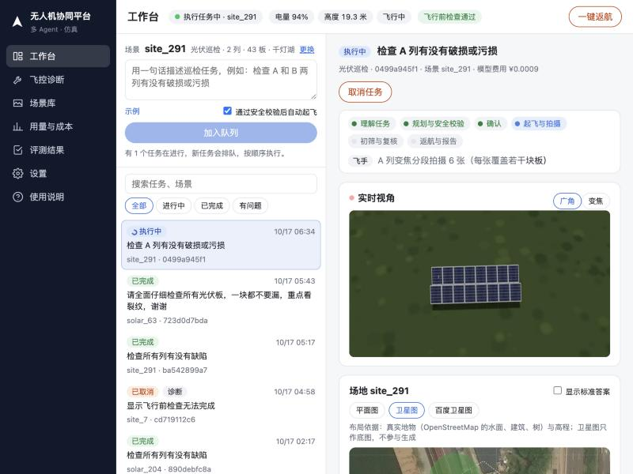
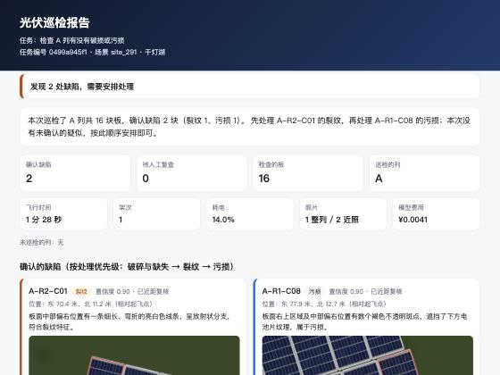
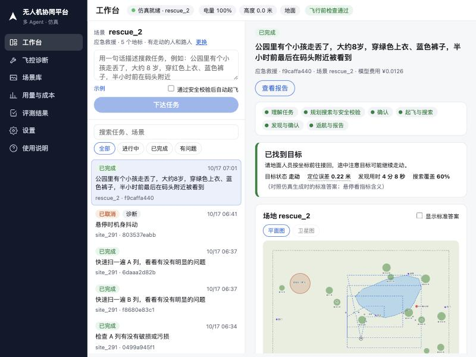
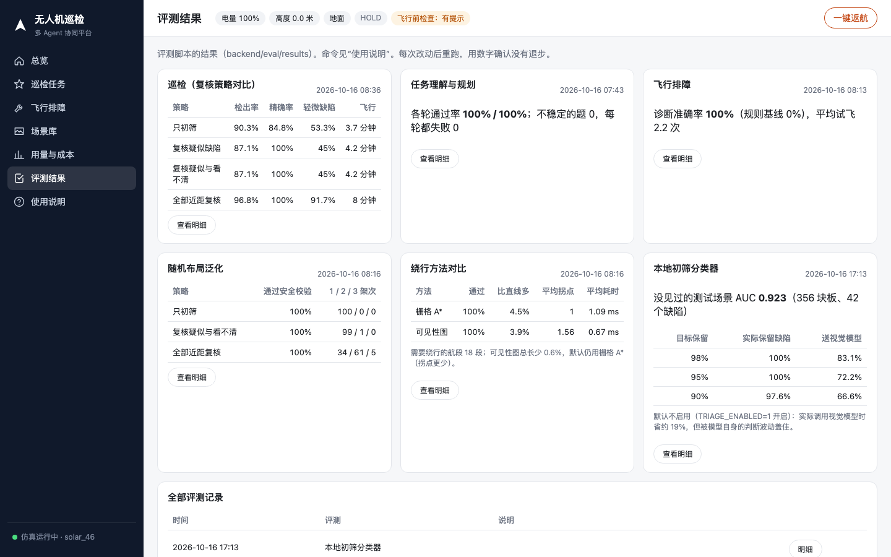

# 用户操作手册

更新：2026-10-17（界面改版、应急救援）

本手册面向第一次使用本系统的人：怎么启动、每个页面做什么、一次巡检从下达到出报告的完整流程、怎么排障、怎么跑评测、常见问题。全部操作都在仿真中进行，不需要真实无人机。

目录

1. 系统是什么
2. 启动与停止
3. 界面总览
4. 完整流程：一次光伏巡检
5. 应急救援
6. 飞控诊断与真实场地
7. 用量与成本、评测结果
8. 命令行：评测与测试
9. 在 Claude Code 等工具里调用（MCP）
10. 常见问题
11. 面试常见追问
12. 出问题时怎么办

---

## 1. 系统是什么

用一句话描述任务，例如“检查 A 和 C 两列有没有破损或污损”，由多个 Agent 分工完成：

| 角色 | 做什么 | 是否调用模型 |
| --- | --- | --- |
| 调度员 | 理解任务，确定要巡检哪些列、细致程度、保留电量；编号不存在时追问，越权请求直接拒绝 | 是 |
| 规划员 | 选择复核策略、拍摄距离、架次，生成航线（含绕开禁飞区的绕行点） | 是 |
| 安全员 | 按确定性规则校验：电子围栏、禁飞区（含航段穿越）、障碍物、限高、电量余量；有否决权 | 否 |
| 人工确认 | 计划在网页上展示，由操作员点“确认起飞”或“不执行” | — |
| 飞手 | 通过 MAVSDK 控制 PX4 起飞、移动、转云台、拍照、换电池、返航 | 否 |
| 巡检员 | 看整列照片（广角一张 + 变焦分段若干张）初筛，再按策略飞近复核可疑的板 | 是（视觉模型） |
| 报告员 | 汇总发现，写结论和 HTML 报告 | 是 |
| 诊断员 | 飞行排障：试飞、对比参数、做对照实验、给出根因 | 是 |

仿真环境：PX4 SITL（飞控）+ Gazebo（无窗口），巡检机为带双相机云台的 x500。场景按随机种子生成，每块光伏板是否有缺陷、什么缺陷都由生成器记录为“标准答案”，因此每次任务都能自动打分。

## 2. 启动与停止

### 2.1 启动前

1. 确认仓库旁边有 `drone-agent-related` 目录（`/Users/jarvislao/Desktop/StudyFile/Coding/drone-agent-related`）：PX4、场景、照片、数据库、数据集都在这里，不需要外置硬盘。
2. `backend/.env` 中已填好 `LLM_API_KEY`（DeepSeek）。这个文件不提交。

### 2.2 一键启动

在项目根目录执行：

```bash
scripts/start.sh solar_46
```

参数是场景名，省略时为 `solar_1`。场景不存在时会按名字里的种子自动生成（`solar_46` 即种子 46）。脚本依次启动仿真（约 30 秒就绪）、后端接口（127.0.0.1:8881）和网页（4790 端口）。

- 本机打开：http://localhost:4790
- 同一局域网的其他设备（手机、平板）：http://192.168.1.112:4790 （脚本会打印实际 IP）

### 2.3 停止

```bash
scripts/start.sh stop
```

日志在 `drone-agent-related/data/logs/`（`api.log`、`web.log`）。

## 3. 界面总览（2026-10-17 改版）

左侧是窄导航栏：工作台、飞控诊断、场景库、用量与成本、评测结果、设置、使用说明。顶部一行任何页面都能看到：

- **仿真状态**（点击可启动、重启、停止、更换场景）：未启动、启动中（显示当前阶段和进度条）、飞行前检查中、就绪、检查不通过、执行任务中；
- 电量、高度、是否在空中；
- **飞行前检查**（点击看明细、几秒前检查的、可以“立即检查”）：只读取飞控和本机状态、天气接口，不调用模型、不花钱，每 15 秒自动刷新；
- **一键返航**：只在飞机可能在空中时出现（已解锁、在空中或有任务在执行）。

操作结果（排队、启动、取消、出错）会在右下角弹出提示。手机上点左上角“菜单”打开导航，点 × 或空白处收起。

| 页面 | 用途 |
| --- | --- |
| 工作台 | 左侧下达任务、历史任务（搜索、筛选，状态实时更新）；右侧是当前任务：顶部是任务、进度和一句话结论，下面分四个页签——概览（计划、报告员结论）、地图（飞行中同时显示实时画面）、过程（团队协作记录）、结果（发现、照片、与标准答案对照）。页签默认跟随任务状态：待确认看概览、飞行中看地图、结束后看结果；手动点过后不再自动切换 |
| 飞控诊断 | 飞机飞得不对时（抖动、转向慢、对不准），让诊断员试飞、对比参数、做对照实验找原因；附诊断记录 |
| 场景库 | 生成场景（光伏巡检 / 应急救援，随机或真实地点）、选中后启动仿真、预览 |
| 用量与成本 | 模型调用的 Token、费用，按日期（北京时间）、角色、模型、任务汇总；评测的调用单独列为“评测” |
| 评测结果 | 各评测最近一次与历史结果 |
| 设置 | 视觉模型推理、变焦分段拍摄等开关，保存后立即生效 |



## 4. 完整流程：一次光伏巡检

### 4.1 选场景并启动仿真

打开“场景库”。顶部操作栏固定在页面上方（往下翻也在）：

1. 左边选应用场景（光伏巡检 / 应急救援）；可选地输入真实地点，输入时会自动出候选（国内用百度，境外用 OpenStreetMap），选一个；
2. 点“随机生成场景”或“在这里生成场景”，新场景出现在列表最前面并自动选中；
3. 点“启动仿真”。顶部显示启动阶段和进度条，约 30–60 秒就绪；启动中可以随时停止。



卡片按创建时间倒序，可以按“真实场地 / 随机场地 / 光伏 / 救援”筛选，超过 12 个分页。双击卡片或点“预览”看场地图（可显示标准答案）。“高级”里可以指定布局编号：同一个编号生成完全相同的布局，用于复现；平时留空即可。场景里的光伏板是程序生成的贴图，不是数据集照片。

### 4.2 下达任务

回到“工作台”。左上方显示当前场景；在输入框里用一句话描述任务，点“示例”可以看按当前场景生成的例句（例如场地只有 A、B 两列时，例句就写 A 和 B）。勾选“通过安全校验后自动起飞”可以跳过人工确认。有任务在进行时，按钮变成“加入队列”：新任务排队，前一个结束后自动开始，每个任务的上下文彼此独立。

### 4.3 确认计划

右侧出现任务：顶部是阶段条（理解任务 → 规划与安全校验 → 确认 → 起飞与拍摄 → 初筛与复核 → 返航与报告），下面一行带扫光动效的文字是当前正在做的事。计划卡片列出巡检的列、复核策略、架次、预计时间和安全员结论，点“确认起飞”或“不执行”。

### 4.4 观察执行

- **实时视角**：执行中每秒刷新一次机载相机画面，可切换广角 / 变焦；



- **地图**：飞机位置与转向平滑移动；真实场地默认显示卫星图（Esri 影像），也可以切换平面图或百度卫星图；地图上方写明布局依据（真实地物与高程，卫星图只作底图）；
- **团队协作记录**：各角色的每一步。

### 4.5 看结果

- **结论**：一句话告诉你这次算不算成功。例如“达标：2 个真实缺陷全部找到，没有误报”，或“未达标：11 个真实缺陷只找到 6 个，漏检 5 个”并建议复检。检出率、精确率的含义悬停可见；
- **对照标准答案**：逐条列出漏检、误报、类型错，点击在地图上定位（漏检的板会闪烁）；
- **发现卡片、照片**、“查看报告”打开 HTML 报告（可打印）。



## 5. 应急救援

在场景库选“应急救援”生成场景。随机场地可以选环境：公园湖泊、山林、河岸、城市广场（不选时按布局编号随机）；也可以搜索真实地点，地面铺该位置的卫星影像，地标只用当地真实存在的地物（查不到时用“场地北侧”等方位描述）。启动仿真后回到工作台。

**怎么下达**：现实中要找的人的特征来自报案人，所以工作台会显示这个场景的**警情卡片**（报案人说的话，可能记错颜色或位置），点“按警情下达”即可；也可以自己写，例如：

> 有个小孩走丢了，大约 8 岁，穿红色上衣、蓝色裤子，半小时前在码头附近

- 调度员没听明白时会追问，**在同一个任务里点“回复”**补充即可（不要重新下达）；不知道长相或位置时直接说“不知道”，系统会改为找出所有人、逐个拍近照交给你辨认，或从场地中心大范围搜索；
- 规划员按环境选搜索方式（扩展方形 / 平行扫描）、半径和高度，程序算出拍摄点，城市广场里高于航线的楼会自动绕开，安全员校验；
- 搜索中：每个拍摄点俯视拍照，程序找出可疑的小块，模型判断是不是人、穿什么、是否在水中；衣着是否相符由程序比对，相符时用变焦相机原地确认；
- 场景里的人会走动，有的目标会落水（河里会顺水漂），山林里的人可能在树冠下被挡住，还有穿同色上衣的路人和地上的同色衣物；
- 结果：找到时给出位置（相对起飞点）、确认照片、是否落水（落水时提示立即派人）；没找到时列出衣着部分一致的人，提示报案描述可能有误；地图上标出看到的每个人；勾选“显示标准答案”可以看目标和路人的真实起点。



## 6. 飞控诊断（原“飞行排障”）

飞机**飞起来有异常**时用（悬停抖动、转向特别慢、近照总对不准）。诊断员会实际起飞一次按固定动作试飞，记录飞行日志指标，把飞控参数与已知良好配置对比，再一次只改一组参数做对照实验，直到找到原因；结束后参数恢复原样，约 3–6 分钟。演示时可以选一个“注入故障”，看诊断员能否找出来。页面右侧是诊断记录。

它和“飞行前检查”不同：飞行前检查只看当前状态、不起飞、不花钱；飞控诊断要试飞、会调用模型。仿真没就绪或有任务在执行时，按钮下方会写明原因。

### 6.1 真实场地（数字孪生）

真实场地取用当地的水面、建筑、树（OpenStreetMap）和高程（Copernicus DEM）：阵列不会放在水面和建筑上，建筑作为障碍物，安全员按地形检查离地高度，起飞天气按该位置判断；仿真地面铺该位置的卫星影像（下载失败时用程序生成的草地）。

## 7. 用量与成本、评测结果

**用量与成本**：可切换 24 小时、7 天、30 天、90 天。

- 顶部：模型调用次数、输入和输出 Token、缓存命中率、图片数、费用；
- 每日费用、每日调用次数柱状图；
- 按角色：哪个 Agent 花得最多（通常是巡检员，因为要看图）；
- 按模型：接口实际返回的模型名；
- 按任务：每个任务的调用次数、图片数、费用，评测产生的调用标为“评测”。

费用按 DeepSeek 官网单价与高峰、闲时时段计算，单价写在 `backend/src/droneagent/pricing.yaml`。


**评测结果**：展示 `backend/eval/results/` 下每类评测最近一次的结果，以及全部历史记录；点“明细”展开每一轮、每个场景、每道题。



各卡片含义：

| 卡片 | 看什么 |
| --- | --- |
| 巡检（复核策略对比） | 四种复核策略的检出率、精确率、轻微缺陷检出、估计飞行时间（随机布局场景） |
| 任务理解与规划 | 20 道题的通过率（含越权请求必须拒绝、编号不存在必须追问） |
| 飞行排障 | 诊断员准确率与“改得最多的参数就是原因”这条规则的对比 |
| 随机布局泛化 | 100 个随机场地上三种策略是否都通过安全校验、需要几个架次 |
| 绕行方法对比 | 栅格 A* 与可见性图在需要绕行的航段上的长度、拐点、耗时 |
| 本地初筛分类器 | 在没见过的场景上能保留多少缺陷、能少送多少板给视觉模型 |

## 8. 命令行：评测与测试

在 `backend` 目录下执行。

| 命令 | 内容 | 是否需要仿真 | 是否调用模型 |
| --- | --- | --- | --- |
| `PYTHONPATH=src uv run python -m droneagent.evaluate layouts --seeds 1-100` | 随机布局：每个种子生成场景，按三种复核策略规划航线并做安全校验 | 否 | 否 |
| `PYTHONPATH=src uv run python -m droneagent.evaluate routes --seeds 1-100` | 绕行方法对比：栅格 A* 与可见性图的通过率、长度、拐点、耗时 | 否 | 否 |
| `PYTHONPATH=src uv run python -m droneagent.evaluate planning --repeat 2` | 任务理解与规划：20 道题（含追问、拒绝、注入指令） | 否 | 是 |
| `PYTHONPATH=src uv run python -m droneagent.evaluate record --scene solar_2` | 录制场景的全部照片，供离线回放 | 是（先停止后端） | 否 |
| `PYTHONPATH=src uv run python -m droneagent.evaluate vision --scenes solar_46,solar_63,solar_71 --repeat 1` | 巡检：离线回放比较四种复核策略 | 否 | 是 |
| `PYTHONPATH=src uv run python -m droneagent.evaluate troubleshoot` | 排障：注入 4 个已知故障，对比诊断员与规则基线 | 是（先停止后端） | 是 |
| `PYTHONPATH=src uv run python -m droneagent.evaluate triage --replay` | 本地初筛分类器：用录制的场景训练，在没见过的场景上评估；`--replay` 真的调用视觉模型对比费用与结果 | 否 | 加 `--replay` 时是 |
| `PYTHONPATH=src uv run python -m droneagent.sim.scene --seed 7 --place 文翰湖公园 --city 佛山` | 按真实地点生成场景（百度检索坐标；有 Mapbox Token 时地面为卫星影像） | 否 | 否 |
| `PYTHONPATH=src uv run python -m droneagent.sim.scene --seed 8 --lat -34.9285 --lon 138.6007 --label "Adelaide 测试场地"` | 直接按经纬度生成场景（国外地点） | 否 | 否 |
| `PYTHONPATH=src uv run python -m droneagent.evaluate real --splits test` | 真实照片：公开光伏缺陷数据集（数据在 `drone-agent-related/datasets/`），按类别统计 | 否 | 是 |
| `PYTHONPATH=src uv run python -m droneagent.evaluate twin --seeds 1-10` | 真实场地数字孪生：5 个真实地点，随机布置与孪生约束布置对比 | 否 | 否 |
| `uv run python -m pytest` | 离线单元测试（70 个） | 否 | 否 |

结果写入 `backend/eval/results/<时间>-<类型>.md` 和 `.json`，网页“评测结果”页自动读取。

需要仿真的评测会独占 MAVLink 端口，运行前先 `scripts/start.sh stop`，结束后再启动。

## 9. 在 Claude Code 等工具里调用（MCP）

后端启动后，可以把系统注册为 MCP 服务，在对话中下达任务：

```bash
claude mcp add drone-agent -- env PYTHONPATH=<backend 绝对路径>/src uv --directory <backend 绝对路径> run python -m droneagent.mcp_server
```

提供的工具：`sim_status`（仿真状态）、`site_info`（场地信息）、`start_inspection`（下达任务，可选自动确认）、`get_mission`（任务详情）、`approve_mission`（确认或拒绝计划）、`cancel_mission`（取消）、`troubleshoot`（排障）。

## 10. 常见问题

**为什么评测这么花钱？**
主要不是“看图”贵，而是视觉模型开着推理时每次输出约 960 个 Token（结论只需约 80 个）。对照实验后已默认关闭推理（`backend/.env` 的 `VISION_THINKING`，默认 off），费用省 75%–86%，复核后的结果不变。评测时加 `--cache` 可以复用相同请求的结论；北京时间高峰时段运行评测会提示单价翻倍。详见 `docs/roadmap.md` 的“成本优化”。

**飞行前检查的“天气”提示不宜起飞，为什么还能飞？**
仿真里的风场和真实天气无关，所以默认只提示。真机部署时在 `backend/.env` 设 `WEATHER_ENFORCE=1`，不通过就拒绝起飞，取不到天气数据也拒绝。

**真实场地的地面为什么还是草地？**
仿真地面是程序生成的平面贴图。国内可稳定使用的卫星影像（百度、高德）不允许下载用作贴图，所以卫星图只在网页上作为底图显示。

**本地初筛分类器怎么开？**
先运行 `evaluate triage` 训练（模型保存在 `drone-agent-related/data/models/triage.pkl`），再在 `backend/.env` 设 `TRIAGE_ENABLED=1`。目前实测只省约 19% 的初筛费用，而且被视觉模型自身的判断波动盖住，所以默认关闭。

**网页打不开，或提示连接失败。**
先确认 `drone-agent-related` 目录在仓库旁边，再执行 `scripts/start.sh stop` 后重新启动。看 `logs/api.log` 是否有报错。

**顶部状态里出现 “Preflight Fail: No connection to the GCS” 或 “Accel TIMEOUT”。**
仿真刚启动时 PX4 的正常提示，后端连上后会消失，不影响起飞。若长时间无法起飞，在“场景库”点当前场景的“重启”。

**任务被拒绝，提示“飞行前检查不通过”。**
飞控或仿真状态异常（传感器超时、位置估计漂移、仿真太慢）。关掉占用资源的程序，在“场景库”重启当前场景，等顶部的“飞行前检查”变绿后重新下达。

**任务中途返航，提示“位置估计漂移”。**
飞行中飞控估计的位置偏离了实际位置，继续拍只会对不准，系统主动中止。处理方法同上。系统不会把对不准的板默认判为正常。

**下达任务后一直没有计划。**
检查 `.env` 中的密钥与网络；模型接口超时会在协作记录里显示错误。

**任务失败了怎么办。**
打开任务详情看协作记录的最后几条。飞行中任何异常都会触发自动返航，飞机不会停在空中。之后可以直接重新下达。

**为什么“只初筛”误报多。**
整列照片里每块板只有几十个像素，阴影和反光容易被当成污损，细小裂纹也看不出来。所以现在每列还会在原地用变焦相机分段拍几张（每块板约 200 像素）再初筛：新场景检出从 73.8% 提到 96.4%，代价是飞行时间变长、大场地更常分两个架次；`backend/.env` 里设 `SEGMENT_SCREEN=0` 可恢复旧做法。近距复核能把误报降到 0，代价是多飞一段时间；规划员会按任务描述自动选择。

**模型费用大概多少。**
普通任务（两列、只复核可疑）约 ¥0.05–0.15；全部近距复核约 ¥0.3–0.4；排障一次约 ¥0.003。以“用量与成本”页为准。

**能换成 GPT 的视觉模型吗。**
可以。`vision` 评测支持 `--provider openai`，需要在 `.env` 中填 OpenAI 的密钥；目前没有对比数据。

## 11. 面试常见追问

**问：航线和场地是不是固定的？是不是只在一个写死的场景里跑通？**

不是。场地按随机种子生成，围栏形状、禁飞区、阵列数量、位置、朝向、行列数、树的位置、缺陷都随种子变化；航线由规划员按场地实时计算，不是预先写好的。证据：

- `evaluate layouts` 对 100 个随机种子逐一生成场地、规划三种策略的航线，并用安全员的规则校验：三种策略全部 100% 通过，“全部近距复核”时按电量自动分为 1 / 2 / 3 架次的分别是 34 / 61 / 5 个场地；
- 单元测试对种子 20–29 检查不变量（阵列在围栏内、互不重叠、避开禁飞区、拍摄点可用）；
- 实时任务在随机场景 solar_46（4 个偏角各不相同的阵列、92 块板、2 个禁飞区、11 个缺陷）上检出率、精确率、类型正确率均为 100%。

**问：随机布局下遇到过什么问题，怎么发现、怎么解决的？**

第一次跑 50 个随机种子，只有 78% 通过：直线航段会穿过禁飞区（拍摄点本身是安全的）。加入绕行后升到 98%，剩下一个场景的两个禁飞区挨得很近，按切线绕行会在两者之间来回。最后改为 2 米网格的 A* 搜索加视线平滑，100 个种子全部通过。这个过程说明“回测”比“演示一次成功”更能暴露问题。

**问：仿真里的结果能代表真机吗？**

不能完全代表，要如实说明：

- 飞控是真实的 PX4 固件（SITL），控制接口 MAVSDK 与真机相同，航线、安全规则、换电池、返航逻辑可以直接迁移；
- 图像是 Gazebo 渲染的贴图，缺陷是生成的，与真实组件的外观有差距；视觉部分需要用公开的真实缺陷数据集补充评测（见 `docs/roadmap.md`）；
- 仿真飞机比真机宽容：例如角速度环增益调高后仿真里仍然稳定，所以排障评测只保留在仿真中能稳定观察到的故障。

**问：落地到真机需要做什么？**

1. 飞控连接从 UDP 仿真端口换成数传或机载电脑的串口，飞行封装不变；
2. 照片和相机位姿从相机桥换成真实相机加飞控姿态（需要标定相机内参与云台安装偏差）；
3. 场地几何从生成器换成测绘数据或现场打点；
4. 空域申请、目视观察员、失联保护等现场规程由人负责，系统只做辅助校验；
5. 先在真实照片上离线评测视觉模型，再小范围试飞。

**问：为什么要多个 Agent，而不是一个大提示词或固定脚本？**

固定脚本处理不了自然语言任务和模糊要求；一个大提示词又无法保证安全。拆开后，需要理解和取舍的部分（任务理解、策略选择、看图、写报告、排障推理）交给模型，必须可靠的部分（围栏、禁飞区、电量）由确定性规则执行并拥有否决权，再加上人工确认。每个环节都有单独的评测。

## 12. 出问题时怎么办

| 现象 | 处理 |
| --- | --- |
| 飞机在空中不动 | 按右上角“一键返航” |
| 想立即停止一切 | `scripts/start.sh stop` |
| 场景贴图看起来没更新 | 仿真不会重新加载贴图，在“场景库”重启该场景 |
| 评测脚本卡住 | 确认后端已停止（端口被占用）；仍卡住时 Ctrl+C 后重试 |
| 磁盘空间不足 | 照片在 `drone-agent-related/data/photos/`，可按任务删除旧目录（先确认不再需要） |

问题记录与排查过程见 `docs/BUGS.yaml` 和 `docs/engineering-log.md`；后续计划见 `docs/roadmap.md`。
